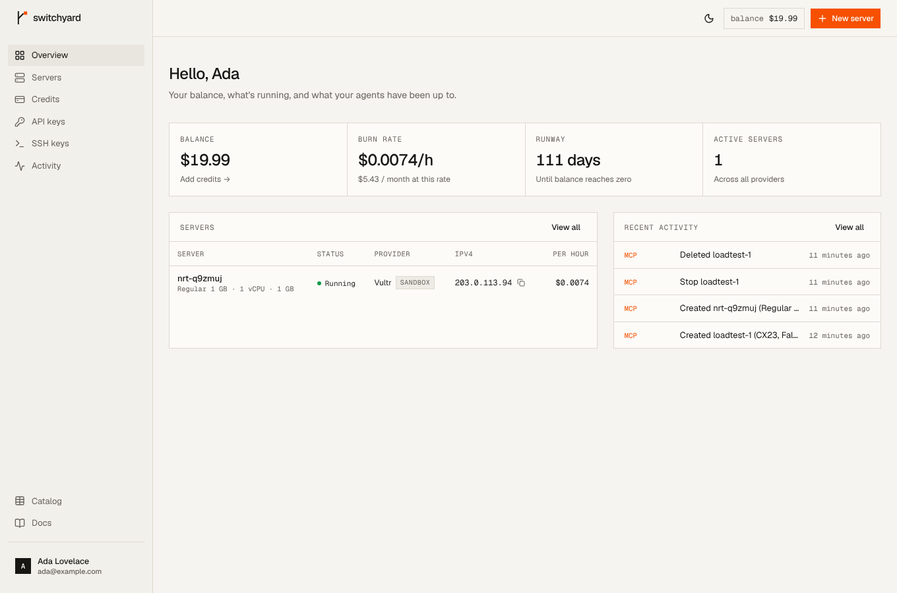
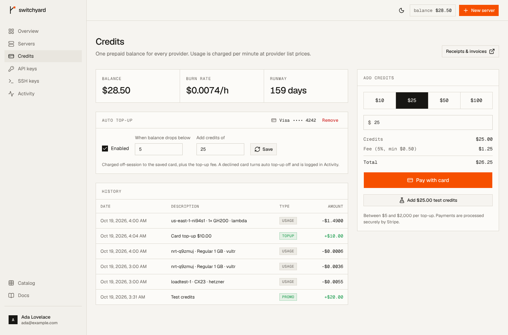

# HessianLabs — the router for hosting

A router for servers, in front of your own cloud accounts. Users connect their
Hetzner, DigitalOcean, Vultr, Akamai Linode, OVHcloud or Scaleway account with
an API token and get **one MCP endpoint and one REST API** across all of them.
An AI agent connected over MCP can ask for "a 4 GB box in Europe", and
HessianLabs picks the cheapest plan that fits on the connected accounts,
provisions it there, hands back SSH access, and deletes it when the agent is
done.

Servers live in the user's account, so the provider bills the user directly at
list price, under its own terms. HessianLabs charges a fee: a percentage of each
server's list price (`PLATFORM_FEE_PERCENT`, 5% by default), per minute, from a
prepaid credit balance. UpCloud, Contabo, Civo, Exoscale and the GPU clouds
(RunPod, Lambda, Vast.ai, CoreWeave, Paperspace, Nebius, Hyperstack) are in the
catalog but coming soon: they can't be connected until their live adapters
land.

This repo is the product: the API, the MCP endpoint and the dashboard. The
public website (landing page, plan catalog and docs) lives in its own repo,
[hessianlabs-ai/landing](https://github.com/hessianlabs-ai/landing), and reads
the catalog from this API's public REST endpoints.

| Dashboard | Credits (Stripe + auto top-up) |
| --- | --- |
|  |  |

## What's in the box

| Area | What it does |
| --- | --- |
| **Cloud accounts** | Users connect one account per provider on the dashboard's Providers page. Credentials are checked with the provider (a cheap authenticated read), sealed with AES-256-GCM under `CREDENTIALS_KEY` (bound to the owner and provider) and never returned. Every few minutes the servers are checked with their provider: one deleted in the provider's console is closed and its fee stops. Disconnecting an account, or credentials that stop working, **detaches** its servers: they keep running in the user's account, unmanaged and with no fee. |
| **Routing** | Describe requirements (vCPU, RAM, disk, continent/country, max $/h, CPU type, arch). The router ranks every matching plan on the user's connected accounts by price — in each plan's cheapest region — and tries up to three candidates, at most two per provider, so a capacity error at one provider falls through to the next. |
| **GPUs & LLM hosting** | Coming soon: the GPU clouds are catalog-only until their live adapters land. GPU plans carry model, count and VRAM. Searches stay CPU-only unless you ask for GPUs (`kind: "gpu"`, `min_vram_gb`, `gpu_models`, `min_gpu_count`). `size_llm` estimates the VRAM an open-weight model needs (weights × 1.2) and returns the cheapest plans that fit. GPU servers boot Ubuntu 22.04 + CUDA 12 by default. |
| **MCP server** | `POST /mcp`, Streamable HTTP, stateless, bearer API key. Searches and creates cover the user's connected accounts. 12 tools: `search_plans`, `size_llm`, `create_server` (optional `ttl_hours`), `get_server` (can wait until running), `list_servers`, `server_action`, `delete_server`, `keep_server`, `get_balance` (includes the account's guardrails), `list_regions`, `list_providers`, `list_images`. |
| **REST API** | The same operations at `/v1`, with the OpenAPI spec at `/v1/openapi.json` and an interactive reference at `/v1/docs`. |
| **Credits** | Prepaid wallet with an append-only ledger. Credits pay HessianLabs's fee; providers bill the servers themselves. A 5% fee (min $0.50) applies to top-ups. Top-ups go through **Stripe Checkout** with the fee as its own line item; webhooks credit the wallet idempotently on the Checkout Session / PaymentIntent id. Optional saved card with **auto top-up** below a threshold (off-session PaymentIntents), refunds claw back credit proportionally, and the Stripe billing portal serves receipts. |
| **Metering** | The fee (`PLATFORM_FEE_PERCENT` of the list price, fixed when the server is created) is charged per minute, aggregated into one ledger row per server per hour, with a one-hour minimum per server. A running estimate of the provider cost at list price is kept alongside. Writes are guarded on `billed_until`, so concurrent workers can't double-bill. |
| **Agent guardrails** | Each API key has an optional lifetime spend cap (measured at provider list price, not just the fee) and a max number of concurrent servers. Both are checked with the wallet and key rows locked, so parallel create calls can't slip past them. Creating a server needs credit for one hour of its fee; an empty balance blocks new servers but never powers off or deletes running ones. Every action goes to an activity log, tagged with the key or teammate that did it. On top, owners and admins set **account-wide guardrails** for agents in Settings → Guardrails: a monthly spend limit (provider cost at list price), a server count, a price cap per server, allowed providers and continents, GPUs on or off, and a **time limit** after which agent servers delete themselves (agents may ask for less, or extend within it with `keep_server`). People in the dashboard aren't limited, and can give any server a time limit. Servers running longer than a threshold (24 hours by default) without one are emailed about once. |
| **Teams** | Invite people by email into an account as admins or members. They share its credits, cloud accounts, servers and keys, and switch between their own account and teams from the account menu. Owners and admins handle billing, cloud accounts, guardrails and the team; members use servers and keys. Account emails (low balance, rejected credentials, failed auto top-ups, time limits, long-running servers) go to the owner and admins, each by their own notification settings. |
| **Account security** | Email verification, password reset, email change with approval from the old inbox, sessions you can sign out, GitHub linking, **two-factor login** (authenticator app plus backup codes), a security log of sign-ins and sign-in changes, and an email when someone signs in from a new device. Data export (JSON, without secrets) and account deletion confirmed by email, blocked while servers run or teammates depend on the account. Invoice details (name, address, VAT number) live on the account's Stripe customer. |
| **SSH** | Keys are injected through cloud-init (never the provider's account-wide key store, which would leak across tenants). Saved keys are used by default; if there are none, a one-time ed25519 key pair is generated and returned once. |
| **Dashboard** | Overview, servers (create / detail / power / delete / time limit), credits, API keys (with ready-to-paste MCP configs), SSH keys, activity, and settings: profile, security, sessions, notifications, data & privacy, team, guardrails and billing details. Its Docs links and the logo on the sign-in pages go to the public website. |

## Stack (chosen with Better-T-Stack)

Scaffolded with `create-better-t-stack` 3.47 (see `bts.jsonc`):

- **Bun + Turborepo** monorepo, **Biome** for lint/format.
- **TanStack Start** (React 19) for the dashboard, which runs client-side behind an auth guard.
- **Hono on Bun** for the API server. It hosts auth, RPC, REST, the MCP endpoint, the Stripe webhook and the billing loops in one process. Web-standard `Request`/`Response` fits the MCP SDK's `WebStandardStreamableHTTPServerTransport` directly.
- **oRPC**: end-to-end types for the dashboard, plus OpenAPI generation for the public REST API from the same procedures.
- **PostgreSQL + Drizzle**: money needs real transactions, `ON CONFLICT` upserts and integer `bigint` amounts (micro-USD).
- **Better Auth** for email/password, plus GitHub when configured.
- **Stripe** for payments (Checkout, off-session PaymentIntents, billing portal). Better-T-Stack offers Polar; Stripe was swapped in for saved-card auto top-ups and broader payment-method coverage.
- **shadcn/ui on Base UI + Tailwind v4** for components.

## Design

The direction comes from the One Page Love SaaS and dev-tool showcases: a
narrow editorial column, monospace labels and terminal-style UI, hairline grids
instead of shadows, bento feature tiles and a single call to action. Warm paper
and ink colours with one signal colour (international orange) used only for the
primary action and live states. Geist and Geist Mono are self-hosted. Light,
dark and mobile are all supported. Tokens live in `packages/ui/src/styles/globals.css`;
the landing repo keeps a copy, so change both.

## Layout

```
apps/
  server/          Hono API: /api/auth, /rpc, /v1 (REST + docs), /mcp, /webhooks/stripe, billing jobs
  web/             TanStack Start app: sign-in and the dashboard
packages/
  cloud/           Provider adapters (6 live, 11 coming soon), catalog cache, routing, GPU/LLM sizing, cloud-init, SSH keygen
  api/             Business logic (wallet, servers, billing, keys, jobs), oRPC routers, MCP tools
  db/              Drizzle schema + migrations
  auth/            Better Auth config
  ui/              Design tokens and shared components
deploy/            Docker Compose Postgres
```

## Run it locally

Requirements: Bun ≥ 1.4 and PostgreSQL (or Docker).

```bash
bun install
cp apps/server/.env.example apps/server/.env    # set BETTER_AUTH_SECRET and CREDENTIALS_KEY
cp apps/web/.env.example apps/web/.env
bun run db:start      # Postgres and MailHog in Docker (or point DATABASE_URL at your own)
bun run db:migrate    # or db:push while iterating on the schema
bun run dev           # web on :3001, API on :3000
```

The landing page runs from its own repo on :3002 (`bun run dev` there), against
this API. The web app's `/` goes straight to the dashboard.

`CREDENTIALS_KEY` seals users' cloud tokens: generate it with
`openssl rand -base64 32` and keep a copy, because losing it means every user
has to reconnect. The example `.env` sets `CLOUD_SANDBOX_ONLY=true`, so every
provider is simulated and any token connects.

Emails (sign-up verification, password resets, email changes) go to MailHog:
read them at http://localhost:8025. Without `SMTP_URL` they're printed to the
API's log instead; in production it's required.

Sign up at http://localhost:3001, connect a provider on the **Providers** page
(any token works in sandbox mode), click **Add test credits** on the Credits
page, create an API key, and connect an agent:

```bash
claude mcp add --transport http hessianlabs http://localhost:3000/mcp \
  --header "Authorization: Bearer hl_live_…"
```

### Sandbox, coming-soon and live providers

Six clouds have live API adapters, and those are the ones users can connect.
The other eleven (UpCloud, Contabo, Civo, Exoscale and all GPU clouds) are
**coming soon**: they appear in the catalog with indicative prices, and the UI
marks them, but they can't be connected until their live adapters land.

`CLOUD_SANDBOX_ONLY=true` simulates every provider, coming-soon ones included:
connecting accepts any token without contacting the provider, and servers walk
through a simulated lifecycle (provisioning → running, with documentation-range
IPs), so the whole product works without a cloud account. It's for development
and demos only; the API refuses to start with it when `NODE_ENV=production`.

The provider tokens in `apps/server/.env` (`HETZNER_API_TOKEN`,
`DIGITALOCEAN_TOKEN`, …) are only used to **read price lists**: give them
read-only access and keep no servers in those accounts. With one set, the
catalog syncs that provider's prices every 6 hours; without one, the provider
serves its reference price list. EUR prices are converted with `EUR_USD_RATE`.
Servers are always created with each user's own credentials.

### Payments (Stripe)

1. Set `STRIPE_SECRET_KEY` (`sk_test_…` while testing) in `apps/server/.env`.
2. Add a webhook endpoint at `https://<api>/webhooks/stripe` for these events:
   `checkout.session.completed`, `checkout.session.async_payment_succeeded`,
   `payment_intent.succeeded`, `payment_intent.payment_failed`, `charge.refunded`.
   Put its signing secret in `STRIPE_WEBHOOK_SECRET`.
3. Save the customer portal settings once in the Stripe dashboard so the
   **Receipts & invoices** button works.

Locally, forward events with the Stripe CLI:

```bash
stripe listen --forward-to localhost:3000/webhooks/stripe   # prints the whsec_… to use
```

No products need to be created: Checkout uses inline prices (credits + fee).

## Deploy with Docker

`deploy/` runs Postgres with Docker Compose. It reads its password from
`apps/server/.env`, the same file local dev uses:

```bash
echo "POSTGRES_PASSWORD=$(openssl rand -hex 24)" >> apps/server/.env
cd deploy && docker compose up -d
```

It listens on `localhost:5433` (loopback only), so point `DATABASE_URL` at
`postgresql://switchyard:<POSTGRES_PASSWORD>@localhost:5433/switchyard` and run
the migrations against it with `bun run db:migrate:deploy` in `packages/db`.

## Tests

```bash
bun run test
```

- `packages/cloud`: provider adapters against a recorded fake HTTP layer (request shapes, price conversion, status mapping, OVH signing, credential checks), routing and region pricing, SSH keygen and cloud-init.
- `packages/api` Stripe tests: real SDK signature verification on signed webhook payloads, with Stripe API calls stubbed. They cover checkout line items, exactly-once crediting, delayed payments, saved cards, proportional refunds, auto top-up success/decline and idempotency against its own webhook, and invoice details with one VAT number per account.
- `packages/api`: integration tests against Postgres (`TEST_DATABASE_URL`, default `switchyard_test`; created automatically). They cover ledger idempotency, sealed credentials, routing to connected accounts with fallback, spend caps and server caps under parallel creates, per-minute fee metering, the one-hour minimum, an empty balance blocking new servers only, closing servers deleted at the provider, detaching on disconnect or rejected credentials, account emails (one low-balance alert per drop, rejected credentials) and their opt-outs, teams (invitations, roles, who gets account emails, admin-only routes), agent guardrails and time limits, long-running alerts, new-device sign-in alerts, deletion blockers, a secret-free data export, and an in-memory MCP client calling the real tools.

## Known gaps before production

- **Coming-soon providers have no live adapters.** The four extra VPS clouds and seven GPU clouds are catalog-only until each gets one (RunPod and Lambda have the simplest APIs to start with). Until then there is no GPU hosting.
- **Stripe hasn't been exercised against Stripe's live API from this environment** (outbound access was blocked). Signature verification, the webhook route and all ledger effects are tested; run a test-mode checkout with `stripe listen` before launch.
- **The live adapters haven't run against real provider APIs yet.** They were written from the providers' API docs and are tested only against a fake HTTP layer. Run each one against a real account before launch — connecting (the credential check), create, power and delete — especially Scaleway's volume cleanup and OVH's `userData` encoding, and confirm the token scopes the Providers page recommends are enough.
- **Prices not modelled:** Scaleway boot volumes (billed separately) and OVH monthly caps. The fee is a percentage of the catalog's list price, not of the user's actual provider bill.
- **One account per provider per user**, and **detached servers can't be re-attached** yet: reconnecting an account doesn't bring its detached servers back under management.
- **MCP auth is bearer-key only.** That works with Claude Code, Cursor, Codex, VS Code and others. Claude.ai web connectors need OAuth; Better Auth's OAuth provider plugin is the natural next step.
- **Not built yet:**
  - low-balance emails
  - rate limiting on `/mcp` and `/v1`
  - rotating `CREDENTIALS_KEY` (sealed values carry a version prefix, but nothing re-encrypts them)
  - an admin view of fees, accounts and usage
