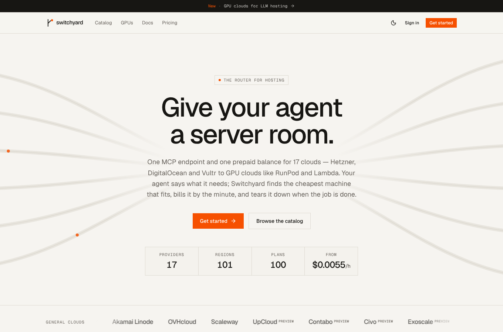
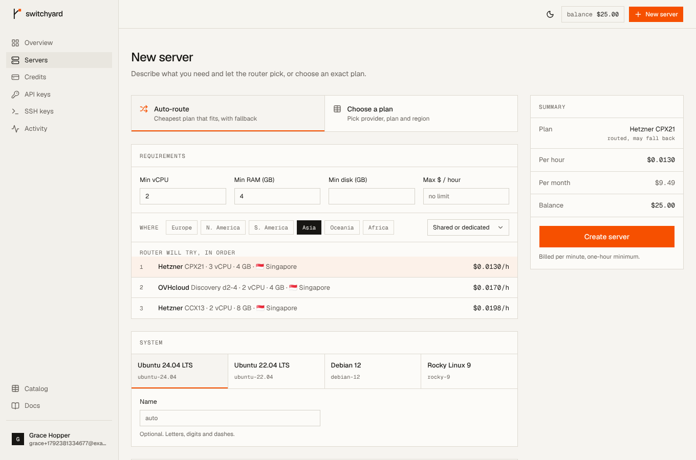
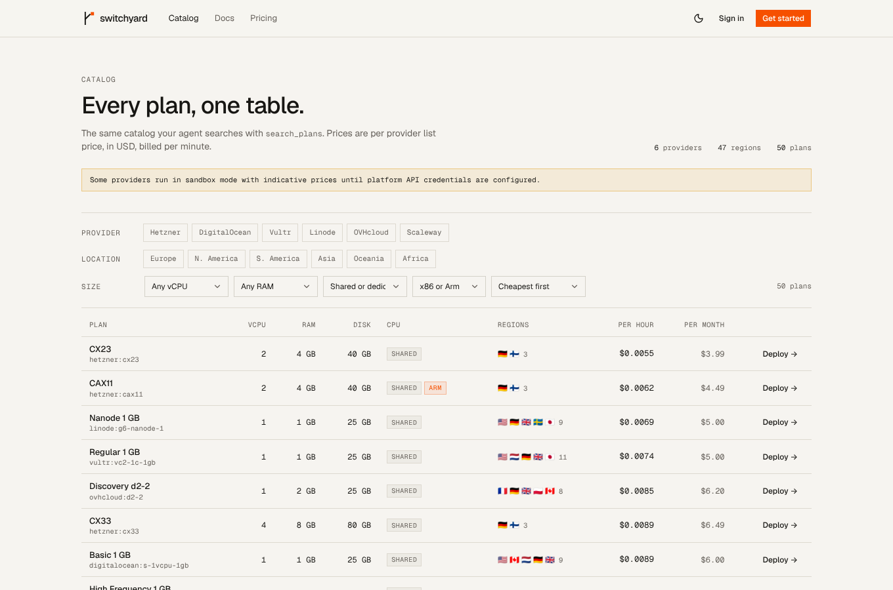
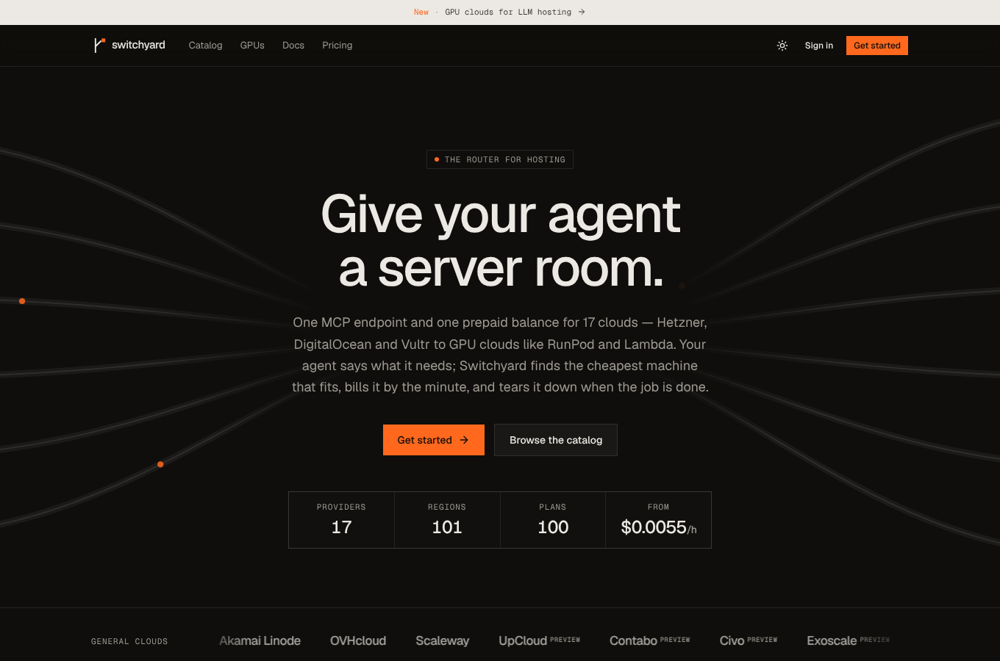

# Switchyard — the router for hosting

OpenRouter, but for servers. Users sign up, add prepaid credits once, and get
**one MCP endpoint and one REST API** in front of 17 clouds: general-purpose
VPS providers (Hetzner, DigitalOcean, Vultr, Akamai Linode, OVHcloud, Scaleway,
UpCloud, Contabo, Civo, Exoscale) and GPU clouds for LLM hosting (RunPod,
Lambda, Vast.ai, CoreWeave, Paperspace, Nebius, Hyperstack). An AI agent
connected over MCP can ask for "a 4 GB box in Europe" or "enough GPU to serve
Llama 3.3 70B", and Switchyard picks the cheapest plan that fits, provisions it,
hands back SSH access, bills it per minute, and destroys it when the agent is
done.

> "Switchyard" is a working name. Rename it in `apps/web/src/lib/site.ts`.



| Dashboard | New server (auto-route) |
| --- | --- |
|  |  |
| **Catalog** | **Dark mode** |
|  |  |

## What's in the box

| Area | What it does |
| --- | --- |
| **Routing** | Describe requirements (vCPU, RAM, disk, continent/country, max $/h, CPU type, arch). The router ranks every matching plan across providers by price — in each plan's cheapest region — and tries up to three candidates, at most two per provider, so a capacity error at one provider falls through to the next. |
| **GPUs & LLM hosting** | GPU plans carry model, count and VRAM. Searches stay CPU-only unless you ask for GPUs (`kind: "gpu"`, `min_vram_gb`, `gpu_models`, `min_gpu_count`). `size_llm` estimates the VRAM an open-weight model needs (weights × 1.2) and returns the cheapest plans that fit. GPU servers boot Ubuntu 22.04 + CUDA 12 by default. |
| **MCP server** | `POST /mcp`, Streamable HTTP, stateless, bearer API key. 11 tools: `search_plans`, `size_llm`, `create_server`, `get_server` (can wait until running), `list_servers`, `server_action`, `delete_server`, `get_balance`, `list_regions`, `list_providers`, `list_images`. |
| **REST API** | The same operations at `/v1`, with the OpenAPI spec at `/v1/openapi.json` and an interactive reference at `/v1/docs`. |
| **Credits** | Prepaid wallet with an append-only ledger. Provider list prices pass through; a 5% fee (min $0.50) applies to top-ups, as with OpenRouter. Top-ups go through **Stripe Checkout** with the fee as its own line item; webhooks credit the wallet idempotently on the Checkout Session / PaymentIntent id. Optional saved card with **auto top-up** below a threshold (off-session PaymentIntents), refunds claw back credit proportionally, and the Stripe billing portal serves receipts. |
| **Metering** | Billed per minute, aggregated into one ledger row per server per hour, with a one-hour minimum per server. Writes are guarded on `billed_until`, so concurrent workers can't double-bill. |
| **Agent guardrails** | Each API key has an optional lifetime spend cap and a max number of concurrent servers. Creating a server needs one hour of credit up front. At zero balance servers are powered off; after 24 hours without a top-up they're destroyed. Every action goes to an activity log, tagged with the key that did it. |
| **SSH** | Keys are injected through cloud-init (never the provider's account-wide key store, which would leak across tenants). Saved keys are used by default; if there are none, a one-time ed25519 key pair is generated and returned once. |
| **Dashboard** | Overview, servers (create / detail / power / delete), credits, API keys (with ready-to-paste MCP configs), SSH keys, activity. Plus a public landing page, plan catalog and docs. |

## Stack (chosen with Better-T-Stack)

Scaffolded with `create-better-t-stack` 3.47 (see `bts.jsonc`):

- **Bun + Turborepo** monorepo, **Biome** for lint/format.
- **TanStack Start** (React 19, SSR). The landing page, catalog and docs render on the server for SEO; the dashboard runs client-side behind an auth guard.
- **Hono on Bun** for the API server. It hosts auth, RPC, REST, the MCP endpoint, the Stripe webhook and the billing loops in one process. Web-standard `Request`/`Response` fits the MCP SDK's `WebStandardStreamableHTTPServerTransport` directly.
- **oRPC**: end-to-end types for the dashboard, plus OpenAPI generation for the public REST API from the same procedures.
- **PostgreSQL + Drizzle**: money needs real transactions, `ON CONFLICT` upserts and integer `bigint` amounts (micro-USD).
- **Better Auth** for email/password, plus GitHub when configured.
- **Stripe** for payments (Checkout, off-session PaymentIntents, billing portal). Better-T-Stack offers Polar; Stripe was swapped in for saved-card auto top-ups and broader payment-method coverage.
- **motion** for the landing page's product showcase animations.
- **shadcn/ui on Base UI + Tailwind v4** for components.

## Design

The direction comes from the One Page Love SaaS and dev-tool showcases: a
narrow editorial column, monospace labels and terminal-style UI, hairline grids
instead of shadows, bento feature tiles and a single call to action. Warm paper
and ink colours with one signal colour (international orange) used only for the
primary action and live states. Geist and Geist Mono are self-hosted. Light,
dark and mobile are all supported. Tokens live in `packages/ui/src/styles/globals.css`.

## Layout

```
apps/
  server/          Hono API: /api/auth, /rpc, /v1 (REST + docs), /mcp, /webhooks/stripe, billing jobs
  web/             TanStack Start app: landing, catalog, docs, auth, dashboard
packages/
  cloud/           Provider adapters (6 live, 11 preview), catalog cache, routing, GPU/LLM sizing, cloud-init, SSH keygen
  api/             Business logic (wallet, servers, billing, keys, jobs), oRPC routers, MCP tools
  db/              Drizzle schema + migrations
  auth/            Better Auth config
  ui/              Design tokens and shared components
```

## Run it locally

Requirements: Bun ≥ 1.4 and PostgreSQL (or Docker).

```bash
bun install
cp apps/server/.env.example apps/server/.env    # set BETTER_AUTH_SECRET
cp apps/web/.env.example apps/web/.env
bun run db:start      # Postgres in Docker (or point DATABASE_URL at your own)
bun run db:migrate    # or db:push while iterating on the schema
bun run dev           # web on :3001, API on :3000
```

Sign up at http://localhost:3001, click **Add test credits** on the Credits
page, create an API key, and connect an agent:

```bash
claude mcp add --transport http switchyard http://localhost:3000/mcp \
  --header "Authorization: Bearer sy_live_…"
```

### Sandbox, preview and live providers

The six original clouds have live API adapters. The other eleven (UpCloud,
Contabo, Civo, Exoscale and all GPU clouds) are **preview** providers: they are
always simulated from an indicative catalog until their live adapters land, and
the UI marks them as preview.

Any provider without credentials runs in **sandbox mode**. It serves an
indicative catalog and simulates the server lifecycle (provisioning → running,
with documentation-range IPs), so the whole product works without a cloud bill.
Set a provider's credentials in `apps/server/.env` to switch it to live; the
catalog then syncs prices from that provider's API every 6 hours. EUR prices are
converted with `EUR_USD_RATE`. `CLOUD_SANDBOX_ONLY=true` forces sandbox mode
everywhere.

### Payments (Stripe)

1. Set `STRIPE_SECRET_KEY` (`sk_test_…` while testing) in `apps/server/.env`.
2. Add a webhook endpoint at `https://<api>/webhooks/stripe` for these events:
   `checkout.session.completed`, `checkout.session.async_payment_succeeded`,
   `payment_intent.succeeded`, `payment_intent.payment_failed`, `charge.refunded`.
   Put its signing secret in `STRIPE_WEBHOOK_SECRET`.
3. Save the customer portal settings once in the Stripe dashboard so the
   **Receipts & invoices** button works.

Locally, forward events with the Stripe CLI:

```bash
stripe listen --forward-to localhost:3000/webhooks/stripe   # prints the whsec_… to use
```

No products need to be created: Checkout uses inline prices (credits + fee).

## Tests

```bash
bun run test
```

- `packages/cloud`: provider adapters against a recorded fake HTTP layer (request shapes, price conversion, status mapping, OVH signing), routing and region pricing, SSH keygen and cloud-init.
- `packages/api` Stripe tests: real SDK signature verification on signed webhook payloads, with Stripe API calls stubbed. They cover checkout line items, exactly-once crediting, delayed payments, saved cards, proportional refunds, auto top-up success/decline and idempotency against its own webhook.
- `packages/api`: integration tests against Postgres (`TEST_DATABASE_URL`, default `switchyard_test`; created automatically). They cover ledger idempotency, fees, routing fallback, spend caps, per-minute metering, the one-hour minimum, suspension and destruction, and an in-memory MCP client calling the real tools.

## Known gaps before production

- **Preview providers are mocks.** The four extra VPS clouds and seven GPU clouds have indicative catalogs and simulated lifecycles only; each needs a live adapter (RunPod and Lambda have the simplest APIs to start with).
- **Stripe hasn't been exercised against Stripe's live API from this environment** (outbound access was blocked). Signature verification, the webhook route and all ledger effects are tested; run a test-mode checkout with `stripe listen` before launch.
- **The live adapters haven't run against real provider APIs yet.** They were written from the providers' API docs and are tested only against a fake HTTP layer. Run each one against a real account before launch, especially Scaleway's volume cleanup and OVH's `userData` encoding.
- **Prices not modelled:** Scaleway boot volumes (billed separately) and OVH monthly caps.
- **MCP auth is bearer-key only.** That works with Claude Code, Cursor, Codex, VS Code and others. Claude.ai web connectors need OAuth; Better Auth's OAuth provider plugin is the natural next step.
- **Not built yet:**
  - low-balance emails
  - rate limiting on `/mcp` and `/v1`
  - bring-your-own provider keys
  - an admin view of margins and provider spend
